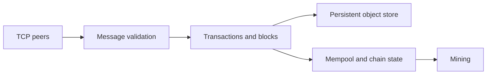

# Kavvadias in Borneo — educational blockchain node

A TypeScript implementation for the NTUA **Blockchain Foundations** programming exercises, Spring 2026. The project explores peer communication, validation, persistent objects, mempool state and proof-of-work mining for the course protocol.

## Implementation map

| Module | Responsibility |
| --- | --- |
| `src/index.ts` | TCP peers, handshake and message handling |
| `src/types.ts` | Protocol types and Zod schemas |
| `src/object.ts` | Canonical object identifiers and LevelDB storage |
| `src/validation.ts` | Transaction and block validation |
| `src/mempool.ts` | Pending transaction state |
| `src/miner.ts` | Course-specific proof-of-work block construction |
| `tests/` | Validation, networking, blocks, mempool and mining exercises |



## Development

Install Bun, then:

```bash
bun install --frozen-lockfile
bun run build
```

To run the node:

```bash
bun run dev
```

The node listens on port **18018** and attempts connections to course bootstrap peers hard-coded in `src/index.ts`. Review these addresses before starting it; this is not an isolated offline simulation. `bun run start` builds and runs the resulting program.

## Tests and scope

```bash
bun test
```

Some tests exercise networking and shared database state. Read their setup before running the full suite alongside a live node. The miner includes assignment-specific parameters and placeholders; it is not a general-purpose cryptocurrency miner.

This repository documents coursework. Preserve course attribution and confirm the course's solution-sharing rules before changing its visibility.
